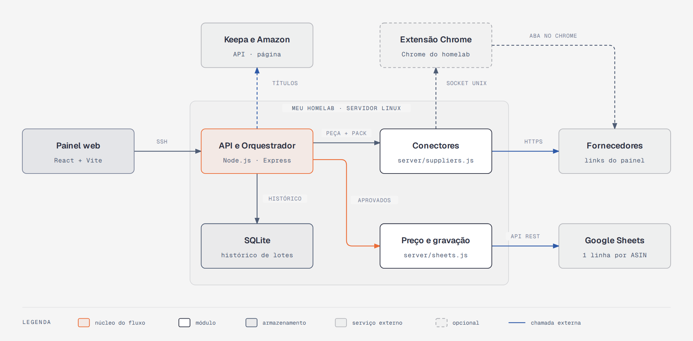

# Buscador de Fornecedores Amazon

> Aplicação web em React, Vite, Node.js e Express para sellers de Amazon FBA e Amazon FBM nos EUA. O robô puxa anúncios pelo Keepa (CSV ou API), consulta preço e estoque em fornecedores, calcula o preço de venda e grava no Google Sheets o lucro, o ROI e a margem para FBM e FBA. Desenvolvi para substituir a pesquisa manual de revenda e rodar no meu homelab Linux Ubuntu 24.

[](https://github.com/mateus-bonette00/buscador-fornecedores-amazon/actions/workflows/ci.yml)
[](web/src/App.jsx)
[](server/app.js)
[](https://developers.google.com/workspace/sheets/api)
[](chrome-extension/manifest.json)


A demonstração acima usa dados de exemplo para mostrar o fluxo de ponta a ponta: cadastro e teste de fornecedores, importação de CSV, aplicação da regra de estoque, filtros, tema escuro e gravação das colunas A a T no Google Sheets. Os testes automatizados também usam respostas simuladas. O repositório não tem dados nem nomes do negócio original.

## Roda no meu homelab

Eu rodo minhas automações e robôs no meu homelab (servidor Linux Ubuntu 24), para o meu notebook de trabalho (também Ubuntu 24) ficar livre. Quis que este projeto funcionasse do mesmo jeito: no notebook fica o painel web em React, e o servidor faz o trabalho pesado.

- O Chrome abre as abas dos fornecedores no servidor, sem tomar a minha tela.
- A VPN, as chaves e a credencial do Google usadas nos lotes ficam no servidor.
- O lote e o teste de fornecedor vão por SSH, com login por chave e conferência do `known_hosts`. O app não abre porta nova para a rede.
- O progresso volta para o painel produto por produto.

Há dois modos. No primeiro, o painel roda no notebook e envia o trabalho por SSH, e o notebook precisa ficar conectado até o lote terminar. No segundo, o painel inteiro vira um serviço `systemd` no homelab, acessado por túnel SSH, e o lote continua mesmo com o notebook desligado. Os comandos estão em [Instalar no homelab](#instalar-no-homelab).

## O que ele faz

Sellers de Amazon FBA e Amazon FBM nos EUA costumam repetir o mesmo processo à mão: exportam ou consultam anúncios no Keepa, abrem cada produto para achar o código da peça, procuram esse código em fornecedores, conferem se há estoque, fazem as contas de lucro FBM e FBA e lançam tudo na planilha.

Este robô automatiza esse caminho e só grava um produto quando consegue confirmar a oferta. Se o título tem mais de um código possível, se um dos fornecedores não confirma o código exato ou se falta estoque, o produto fica pendente no painel com o motivo escrito.

Quando dá para confirmar, ele:

- recebe os produtos pelo Keepa (CSV exportado ou consulta direta na API do Keepa) ou por uma lista de ASINs e links da Amazon
- busca pelo Keepa os títulos que faltam e separa o código da peça e o tamanho do pack em títulos como `Pack of 10 KQ2F11-35A`
- compara os fornecedores e escolhe um pelas regras de estoque
- calcula o preço de venda em centavos inteiros e grava a linha do ASIN no Google Sheets com as fórmulas de lucro, ROI e margem para Amazon FBM (envio pelo vendedor) e Amazon FBA (envio pela Amazon)
- relê a planilha depois de gravar para conferir se o preço e as margens FBM e FBA bateram

Os lotes rodam em segundo plano, com três produtos consultados por vez, e o histórico fica em SQLite.

## Painel web


O frontend foi construído em React com Vite (`web/`) e servido pelo Express em produção (`dist/`). A tela divide o formulário de novo lote ao lado do histórico em SQLite, com a tabela de resultados abaixo.

- No topo, uma barra mostra o estado das integrações (`Keepa API`, `Google Sheets`, `VPN SMC EUA` ou `Servidor homelab`). Se o navegador perder contato com o backend local, aparece um aviso com botão para tentar novamente.
- A interface abre em tema claro por padrão, acompanha a preferência do sistema operacional e permite alternar entre tema claro e escuro pelo botão no topo.
- A tabela exibe `Part Number`, `ASIN`, ofertas por fornecedor e a coluna `Lucro FBM / FBA` lado a lado. Na simulação aparecem as estimativas padrão; após a gravação, os valores são trocados pelos números conferidos na planilha.
- Filtros rápidos (`Todos`, `Confirmados`, `Pendentes`) mostram a contagem de cada grupo sem recarregar o lote, e cada execução do histórico atualiza a URL (`?job=<id>`) para funcionar com os botões Voltar e Avançar do navegador.

## Como foi feito

O frontend usa React 18 com Vite, organizado em componentes pequenos e sem bibliotecas de UI pesadas. O backend roda em Node.js 20 com Express, SQLite (`better-sqlite3`) para o histórico dos lotes e `htmlparser2` para leitura de HTML e JSON-LD.

A integração com o Google Sheets não usa SDK. O app assina o JWT RS256 da conta de serviço direto com `node:crypto` e chama a API REST v4.

Para ler páginas de fornecedores no navegador, há uma extensão do Chrome (Manifest V3) que conversa com o Node.js (`server/chrome-native.js`) por Native Messaging e um socket Unix. Ela envia apenas os campos que o app precisa ler.

O servidor Express escuta apenas em `127.0.0.1`, valida os cabeçalhos `Host` e `Origin`, aplica Content Security Policy, recusa redirecionamentos para outro domínio e bloqueia IPs privados nos links de fornecedor.

## Decisões de engenharia

**Recusar em caso de dúvida.** Preferi deixar um produto pendente a gravar uma oferta errada na planilha. Por isso cada pendência mostra o motivo.

**React + Vite com backend em Node.js e Express.** Toda a base fica em JavaScript, do painel até a API, a fila de lotes e a ponte da extensão do Chrome. Em desenvolvimento o Vite faz proxy de `/api` para o Express; em produção o Express serve o bundle estático de `dist/`.

**JWT assinado com `node:crypto`.** Em vez de instalar o SDK do Google, eu monto o JWT da conta de serviço com a criptografia nativa do Node.js e chamo a API REST diretamente. São poucas linhas, e o fluxo fica visível no código.

**Extensão para páginas que exigem navegador.** Algumas páginas de fornecedor só respondem bem com uma sessão aberta no Chrome. A extensão conversa com `server/chrome-native.js` por Native Messaging e socket Unix.

**Limitações que eu conheço.** O cálculo assume que o pacote da loja tem o mesmo tamanho do anúncio. O leitor genérico depende do que cada site publica: sem a quantidade em estoque ou com uma faixa de preço, o produto fica pendente. Os testes usam respostas simuladas. Se eu retomasse o projeto para operação contínua, trocaria a leitura de páginas por catálogos oficiais.

## Arquitetura



O arquivo editável do diagrama é o [`docs/arquitetura.html`](docs/arquitetura.html).

### Fluxo de uma pesquisa

1. Você informa a marca, escolhe os fornecedores e a origem: CSV, ASINs, links da Amazon ou uma consulta no Keepa.
2. O painel React envia o lote para a API Express local, que coloca o pedido na fila.
3. Com uma chave do Keepa, o backend busca os títulos que faltam. Se ainda faltar um título, tenta ler a página do anúncio na Amazon.
4. De cada título saem o código da peça e o tamanho do pack.
5. Os conectores consultam os fornecedores por HTTPS ou por uma aba do Chrome.
6. O app escolhe o fornecedor e calcula o preço de venda.
7. No fim do lote, os produtos aprovados vão para o Google Sheets, um por linha, com os cálculos de lucro, ROI e margem para FBM e FBA.
8. O app relê as linhas e só marca um produto como gravado se o preço e as margens FBM e FBA baterem.

### Regras de negócio

| Tema | Regra |
|---|---|
| Código da peça | Precisa ser exato. Códigos parecidos são ignorados |
| Estoque mínimo | 11, ou o tamanho do pack quando ele for maior |
| Escolha entre as lojas | Motion, até o estoque da SMC chegar a 2,4 vezes o da Motion |
| Prazo | 5 dias na Motion. Na SMC, 6 com envio no mesmo dia e 7 com envio no dia seguinte |
| Frete | US$ 40 na Motion e US$ 70 na SMC |
| Preço de venda e lucro FBM | Margem de cerca de 24%, com comissão de 15% da Amazon e US$ 7 de preparo |
| Lucro FBA | Mesma base do FBM, descontando também a taxa FBA da Amazon (padrão US$ 6, editável por linha na planilha) |

Um exemplo com a Motion: o custo de US$ 17,85, mais US$ 7 de preparo e US$ 40 de frete, dá US$ 64,85. O app calcula a venda em US$ 106,31. Descontada a comissão de 15% da Amazon (US$ 15,95), o lucro FBM fica perto de US$ 25,51 (margem de 24%). No FBA, descontando a taxa FBA padrão de US$ 6, o lucro fica perto de US$ 19,51 (margem de 18,35%). As fórmulas da planilha calculam lucro, ROI e margem dos dois modelos automaticamente.

Os fornecedores usados aqui vendem por pacote, por isso o preço exibido já é o custo do pack. O app parte do princípio de que o pacote da loja é igual ao do anúncio. Ele não consulta o preço dos concorrentes.

## Como rodar

### Pré-requisitos

- Linux (testado no Ubuntu 24) e Node.js 20 ou mais recente
- Uma conta de serviço do Google Cloud, para gravar na planilha
- Google Chrome 120 ou mais recente, para a extensão
- Chave da API do Keepa, para buscar produtos por lá

### 1. Clonar e instalar

```bash
git clone https://github.com/mateus-bonette00/buscador-fornecedores-amazon.git
cd buscador-fornecedores-amazon
npm install
```

### 2. Testar com a simulação

Modo produção local (gera o build do Vite automaticamente na primeira vez e sobe o Express):

```bash
npm start
```

Abra `http://127.0.0.1:8746`, deixe a origem em Simulação e clique em "Iniciar simulação". Devem aparecer 2 produtos simulados e 1 pendente. Não precisa de conta nem de chave.

Para desenvolver o frontend com recarregamento instantâneo do Vite:

```bash
npm run dev:server   # terminal 1: API Express em 127.0.0.1:8746
npm run dev          # terminal 2: Vite em 127.0.0.1:5173 com proxy para /api
```

### 3. Conectar a planilha

```bash
mkdir -p ~/.config/buscador-fornecedores-amazon
cp examples/settings.example.json ~/.config/buscador-fornecedores-amazon/settings.json
```

Preencha `spreadsheet_id` e `sheet_id`. O [`docs/PLANILHA.md`](docs/PLANILHA.md) explica as colunas A a T e como criar a conta de serviço.

### 4. Escolher de onde vêm os produtos

Sem a API do Keepa, importe um CSV com a coluna `ASIN` ou cole um ASIN ou link da `amazon.com` por linha. O arquivo [`examples/produtos-exemplo.csv`](examples/produtos-exemplo.csv) mostra o formato, com ASINs fictícios.

Para usar a API, salve a chave em `~/.config/buscador-fornecedores-amazon/keepa.key` e escolha "Consulta no Keepa" no painel. Você pode buscar pela marca ou colar o JSON de *Show API query* do Product Finder.

### 5. Adicionar os fornecedores

No painel, cole os links dos sites onde o robô deve procurar. Pode ser a página inicial, uma busca, uma categoria ou a página de um produto, com até 10 links por site e 8 sites por lote. Os links do mesmo site viram um fornecedor, com frete e prazo próprios. A lista fica salva no navegador.


Antes do lote, use "Testar" com um part number que o site venda. O painel mostra o preço e a quantidade que leu, ou o motivo de não ter conseguido. Se você colar o link de uma busca feita com esse mesmo código, o teste troca o código por `{part}`, evita links duplicados e passa a repetir a busca para cada produto. O teste atualiza só o fornecedor testado, mantendo o que você estiver digitando nos demais.

Motion e SMC têm leitores próprios. Os outros sites passam pelo leitor genérico, que só confirma uma oferta quando a página traz:

- o código exato da peça, nos dados `schema.org` ou num rótulo como `Part Number`
- um único preço em dólar
- a quantidade em estoque (só "In stock" não basta)

O leitor genérico faz a leitura sem navegador. Sites que bloqueiam robôs ou montam a página com JavaScript ficam pendentes, e muitas lojas não publicam a quantidade.

A Motion costuma recusar a leitura direta, então use a extensão do Chrome. Registre o host local:

```bash
node ops/setup-chrome.js
```

Depois, em `chrome://extensions`, ative o modo do desenvolvedor, clique em "Carregar sem compactação" e selecione a pasta `chrome-extension/`. Adicione `"supplier_chrome": true` ao `settings.json` e deixe o Chrome aberto durante o lote.

A consulta à SMC precisa sair por um IP dos Estados Unidos. Você pode informar um proxy HTTP em `smc_proxy` ou usar `"smc_proton_manual": true` e conectar o Proton VPN antes de começar. O app confere a conexão pelo `nmcli`. Ligar e desligar a VPN continua com você.

## Estrutura do projeto

```
buscador-fornecedores-amazon/
├── server/
│   ├── index.js                 # CLI do servidor Express e worker SSH (--run-job)
│   ├── app.js                   # Rotas REST em Express, segurança e entrega do build React
│   ├── jobs.js                  # Fila de lotes, SQLite, Keepa, escolha de fornecedor e SSH
│   ├── suppliers.js             # Leitores da Motion, da SMC e leitor genérico com proteção SSRF
│   ├── sheets.js                # Cálculo FBM/FBA, JWT via node:crypto e Google Sheets API v4
│   ├── vpn.js                   # Confere a VPN EUA pelo nmcli antes de consultar a SMC
│   └── chrome-native.js         # Ponte Native Messaging + socket Unix com o Chrome
├── web/
│   ├── index.html               # Entrada do Vite
│   ├── public/favicon.svg       # Ícone da aplicação
│   └── src/                     # Painel em React (App, componentes e estilos)
├── chrome-extension/
│   ├── manifest.json            # Manifest V3
│   └── worker.js                # Abre a aba, lê os campos e fecha
├── test/
│   └── app.test.js              # Suíte de testes com node:test
├── ops/
│   ├── start.sh                 # Build automático (se necessário) e execução local ou remota
│   ├── setup-chrome.js          # Registra server/chrome-native.js no perfil do Chrome
│   └── buscador-fornecedores-amazon.service
├── docs/                        # Planilha, diagrama, capturas e GIF de demonstração
├── examples/                    # CSV, planilha modelo e configuração de exemplo
├── .github/workflows/ci.yml     # Build e testes no GitHub Actions
├── vite.config.js               # Configuração do Vite e proxy de desenvolvimento
└── package.json
```

## Personalização

| Para mudar | Edite |
|---|---|
| Planilha de destino | `spreadsheet_id` e `sheet_id` no `settings.json` |
| Frete e prazo | Campos de cada fornecedor no painel |
| Estoque mínimo | `supplierRules` no `server/jobs.js`, ou `suppliers` no `settings.json` para Motion e SMC |
| Preparo de um produto já gravado | Coluna "Preparo (US$)" da planilha |
| Taxa FBA de um produto já gravado | Coluna "Taxa FBA (US$)" da planilha |
| Preparo e taxa FBA padrão | `DEFAULT_PREP` e `DEFAULT_FBA_FEE` em `server/sheets.js` e `web/src/api.js` |
| Margem e taxa da Amazon | `server/sheets.js`: `soldFor`, `formulas` e conferência das margens FBM e FBA |
| Regra entre Motion e SMC | Função `choose` no `server/jobs.js` |
| Colunas da planilha | `server/sheets.js` e `docs/PLANILHA.md` |
| Leitor próprio para outro site | `DRIVERS` no `server/suppliers.js` e `KNOWN_DOMAINS` no `server/jobs.js` |
| Visual do painel e temas | `web/src/styles.css` |
| Porta | `node server/index.js --port 9000` |

## Testes

```bash
npm run build   # gera o bundle de produção do React com Vite
npm test        # 20 testes em Node.js + checagem de sintaxe da extensão Chrome
```

São 20 testes automatizados usando `node:test`, além da checagem de sintaxe de `chrome-extension/worker.js` e do build do Vite no CI. Um cobre o teste de fornecedor no homelab via SSH. Três cobrem o servidor Express (`total` inicial na preparação de lotes, rotas de favicon, fluxo completo de simulação pela API e bloqueio de `Origin` externo). Cinco cobrem os links de fornecedor: leitor genérico, agrupamento e bloqueio de endereços internos. Seis cobrem leitura do título, preço de venda, escolha do fornecedor, prazo da SMC, código exato na Motion e ASINs repetidos. Três cobrem a gravação na planilha com as fórmulas e margens FBM e FBA, e dois cobrem a checagem da VPN. O GitHub Actions roda build e testes a cada push e pull request.

Eles não abrem a extensão no Chrome. A leitura das lojas depende do layout das páginas, e um site pode recusar consultas automáticas. Nesses casos o produto fica pendente. Respeite os termos de uso de cada site.

## Roadmap

- [x] Gravar um GIF de demonstração
- [ ] Testes automatizados do painel e da extensão no navegador
- [ ] Exportar o resultado em CSV pelo painel

## Instalar no homelab

Copie o projeto para o servidor Linux Ubuntu 24, trocando `meu-homelab` pelo seu alias SSH com login por chave, já registrado no `known_hosts`:

```bash
ssh meu-homelab 'mkdir -p ~/.local/share/buscador-fornecedores-amazon'
rsync -a --exclude .git --exclude node_modules --exclude dist ./ meu-homelab:.local/share/buscador-fornecedores-amazon/
ssh meu-homelab 'cd ~/.local/share/buscador-fornecedores-amazon && npm ci && npm run build'
```

As credenciais e o `settings.json` também ficam no servidor. Para usar a extensão, o servidor precisa de uma sessão gráfica com o Chrome aberto.

### Modo 1: painel no notebook, trabalho no homelab

```bash
WORKER_HOST=meu-homelab npm start
```

### Modo 2: tudo no homelab

```bash
# no servidor
cd ~/.local/share/buscador-fornecedores-amazon
mkdir -p ~/.config/systemd/user
cp ops/buscador-fornecedores-amazon.service ~/.config/systemd/user/
systemctl --user daemon-reload
systemctl --user enable --now buscador-fornecedores-amazon
loginctl enable-linger "$USER"   # mantém o serviço ativo sem sessão aberta

# no seu computador
ssh -L 8746:127.0.0.1:8746 meu-homelab
```

Com o túnel aberto, acesse `http://127.0.0.1:8746`.

## Licença

© 2026 Mateus de Freitas Bonette. O código está publicado como portfólio, sem licença de código aberto, com todos os direitos reservados.

Projeto independente, sem vínculo com Amazon, Keepa, Motion, SMC, Google ou Proton. Os nomes pertencem aos respectivos donos.

## Stack

[React](https://react.dev) · [Vite](https://vite.dev) · [Node.js](https://nodejs.org) · [Express](https://expressjs.com) · [SQLite](https://www.sqlite.org) · [Google Sheets API](https://developers.google.com/workspace/sheets/api) · [Keepa API](https://keepa.com/#!api) · [Chrome Extensions](https://developer.chrome.com/docs/extensions) · [GitHub Actions](https://docs.github.com/actions)
