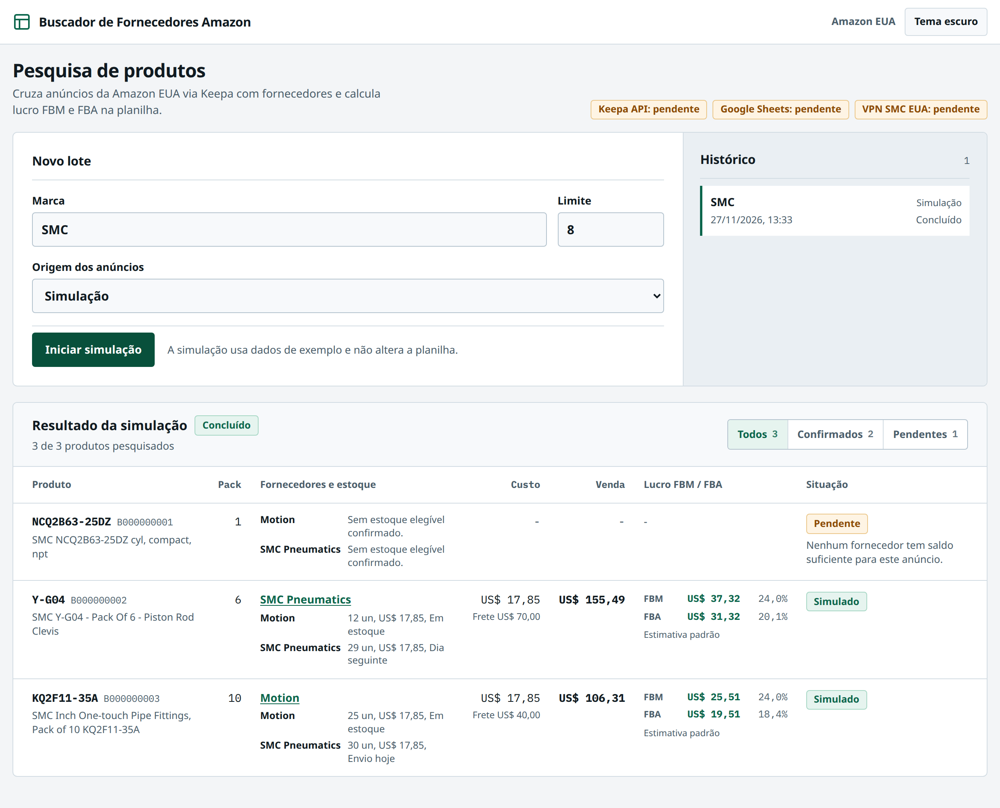
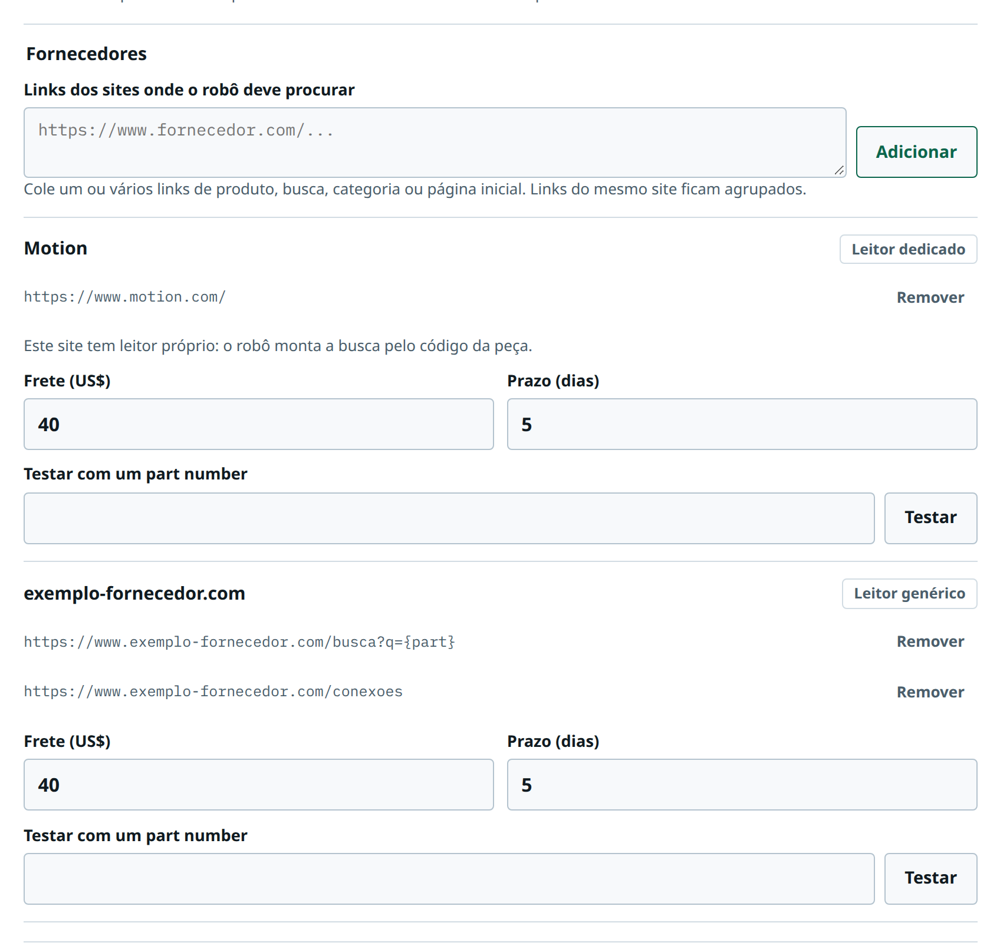

# Buscador de Fornecedores Amazon

> Robô com painel web que puxa anúncios da Amazon dos EUA pelo Keepa (CSV ou API), consulta preço e estoque em fornecedores, calcula o preço de venda e grava na planilha do Google Sheets o lucro, o ROI e a margem para Amazon FBM e FBA. Desenvolvi para substituir uma pesquisa de revenda feita à mão e rodar no meu homelab.

[](https://github.com/mateus-bonette00/buscador-fornecedores-amazon/actions/workflows/ci.yml)
[](https://www.python.org/downloads/)
[](web/app.js)
[](https://developers.google.com/workspace/sheets/api)
[](chrome-extension/manifest.json)


A demonstração acima usa dados de exemplo para mostrar o fluxo de ponta a ponta: cadastro e teste de fornecedores, importação de CSV, aplicação da regra de estoque, filtros, tema escuro e gravação das colunas A a T no Google Sheets. Os testes automatizados também usam respostas simuladas. O repositório não tem dados nem nomes do negócio original.

## Roda no meu homelab

Eu rodo minhas automações e robôs no meu homelab, para o notebook de trabalho ficar livre. Quis que este projeto funcionasse do mesmo jeito: no notebook fica o painel, e o servidor faz o trabalho.

- O Chrome abre as abas dos fornecedores no servidor, sem tomar a minha tela.
- A VPN, as chaves e a credencial do Google usadas nos lotes ficam no servidor.
- O lote e o teste de fornecedor vão por SSH, com login por chave e conferência do `known_hosts`. O app não abre porta nova para a rede.
- O progresso volta para o painel produto por produto.

Há dois modos. No primeiro, o painel roda no notebook e envia o trabalho por SSH, e o notebook precisa ficar conectado até o lote terminar. No segundo, o painel inteiro vira um serviço no homelab, acessado por túnel SSH, e o lote continua mesmo com o notebook desligado. Os comandos estão em [Instalar no homelab](#instalar-no-homelab).

## O que ele faz

Quem revende produtos na Amazon dos EUA normalmente repete o mesmo trabalho à mão: exporta ou consulta produtos no Keepa, abre cada anúncio para achar o código da peça, procura esse código em fornecedores, confere se há estoque, faz as contas de lucro FBM e FBA e lança tudo na planilha.

Este robô automatiza esse caminho e só grava um produto quando consegue confirmar a oferta. Se o título tem mais de um código possível, se um dos fornecedores não confirma o código exato ou se falta estoque, o produto fica pendente no painel com o motivo escrito.

Quando dá para confirmar, ele:

- recebe os produtos pelo Keepa (CSV exportado ou consulta direta na API do Keepa) ou por uma lista de ASINs e links da Amazon
- busca pelo Keepa os títulos que faltam e separa o código da peça e o tamanho do pack em títulos como `Pack of 10 KQ2F11-35A`
- compara os fornecedores e escolhe um pelas regras de estoque
- calcula o preço de venda e grava a linha do ASIN no Google Sheets com as fórmulas de lucro, ROI e margem para FBM (envio pelo vendedor) e FBA (envio pela Amazon)
- relê a planilha depois de gravar para conferir se o preço e as margens FBM e FBA bateram

Os lotes rodam em segundo plano, com três produtos consultados por vez, e o histórico fica em SQLite.

## Painel web



O painel organiza a pesquisa em duas áreas: o formulário de novo lote ao lado do histórico de execuções em SQLite, e abaixo a tabela de resultados.

- No topo, uma barra mostra o estado das integrações (`Keepa API`, `Google Sheets`, `VPN SMC EUA` ou `Servidor homelab`). Se o navegador perder contato com o backend local, aparece um aviso com botão para tentar novamente.
- A interface abre em tema claro por padrão, acompanha a preferência do sistema operacional e permite alternar entre tema claro e escuro pelo botão no topo.
- A tabela exibe `Part Number`, `ASIN`, ofertas por fornecedor e a coluna `Lucro FBM / FBA` lado a lado. Na simulação aparecem as estimativas padrão; após a gravação, os valores são trocados pelos números conferidos na planilha.
- Filtros rápidos (`Todos`, `Confirmados`, `Pendentes`) mostram a contagem de cada grupo sem recarregar o lote, e cada execução do histórico atualiza a URL (`?job=<id>`) para funcionar com os botões Voltar e Avançar do navegador.

## Como foi feito

O backend usa só a biblioteca padrão do Python, então não há pacote para instalar com `pip`. O painel é HTML, CSS e JavaScript sem framework.

A integração com o Google Sheets não usa SDK. O app assina o JWT da conta de serviço com o `openssl` e chama a API REST.

Para ler páginas de fornecedores no navegador, fiz uma extensão do Chrome que conversa com o Python por Native Messaging e um socket Unix. Ela envia apenas os campos que o app precisa ler.

O painel atende em `127.0.0.1`, confere os cabeçalhos `Host` e `Origin`, define uma Content Security Policy e recusa redirecionamento para outro domínio. Também dá para deixar o painel no seu computador e executar os lotes em um servidor por SSH.

## Decisões de engenharia

**Recusar em caso de dúvida.** Preferi deixar um produto pendente a gravar uma oferta errada na planilha. Por isso cada pendência mostra o motivo.

**Sem dependências no backend.** Escrevi tudo com a biblioteca padrão do Python. Assim o projeto roda sem ambiente virtual e a superfície de manutenção fica menor.

**JWT assinado com OpenSSL.** Em vez de instalar o SDK do Google, eu monto o JWT da conta de serviço e chamo a API REST diretamente. São poucas linhas, e o fluxo fica visível no código.

**Extensão para páginas que exigem navegador.** Algumas páginas de fornecedor só respondem bem com uma sessão aberta no Chrome. Então ligo a extensão ao Python por Native Messaging e socket Unix.

**Limitações que eu conheço.** O cálculo assume que o pacote da loja tem o mesmo tamanho do anúncio. O leitor genérico depende do que cada site publica: sem a quantidade em estoque ou com uma faixa de preço, o produto fica pendente. Os testes usam respostas simuladas. Se eu retomasse o projeto, trocaria a leitura de páginas por catálogos oficiais.

## Arquitetura


O arquivo editável do diagrama é o [`docs/arquitetura.html`](docs/arquitetura.html).

### Fluxo de uma pesquisa

1. Você informa a marca, escolhe os fornecedores e a origem: CSV, ASINs, links da Amazon ou uma consulta no Keepa.
2. O painel envia o lote para a API local, que coloca o pedido na fila.
3. Com uma chave do Keepa, o app busca os títulos que faltam. Se ainda faltar um título, tenta ler a página do anúncio na Amazon.
4. De cada título saem o código da peça e o tamanho do pack.
5. Os conectores consultam os fornecedores por HTTPS ou por uma aba do Chrome.
6. O app escolhe o fornecedor e calcula o preço de venda.
7. No fim do lote, os produtos aprovados vão para o Google Sheets, um por linha, com os cálculos de lucro, ROI e margem para FBM e FBA.
8. O app relê as linhas e só marca um produto como gravado se o preço e as margens FBM e FBA baterem.

### Regras de negócio

| Tema | Regra |
|---|---|
| Código da peça | Precisa ser exato. Códigos parecidos são ignorados |
| Estoque mínimo | 11, ou o tamanho do pack quando ele for maior |
| Escolha entre as lojas | Motion, até o estoque da SMC chegar a 2,4 vezes o da Motion |
| Prazo | 5 dias na Motion. Na SMC, 6 com envio no mesmo dia e 7 com envio no dia seguinte |
| Frete | US$ 40 na Motion e US$ 70 na SMC |
| Preço de venda e lucro FBM | Margem de cerca de 24%, com comissão de 15% da Amazon e US$ 7 de preparo |
| Lucro FBA | Mesma base do FBM, descontando também a taxa FBA da Amazon (padrão US$ 6, editável por linha na planilha) |

Um exemplo com a Motion: o custo de US$ 17,85, mais US$ 7 de preparo e US$ 40 de frete, dá US$ 64,85. O app calcula a venda em US$ 106,31. Descontada a comissão de 15% da Amazon (US$ 15,95), o lucro FBM fica perto de US$ 25,51 (margem de 24%). No FBA, descontando a taxa FBA padrão de US$ 6, o lucro fica perto de US$ 19,51 (margem de 18,35%). As fórmulas da planilha calculam lucro, ROI e margem dos dois modelos automaticamente.

Os fornecedores usados aqui vendem por pacote, por isso o preço exibido já é o custo do pack. O app parte do princípio de que o pacote da loja é igual ao do anúncio. Ele não consulta o preço dos concorrentes.

## Como rodar

### Pré-requisitos

- Linux e Python 3 (testado no 3.12)
- Node.js, opcional, para `npm start` e `npm test`
- `openssl` e uma conta de serviço do Google Cloud, para gravar na planilha
- Google Chrome 120 ou mais recente, para a extensão
- Chave da API do Keepa, para buscar produtos por lá

### 1. Clonar

```bash
git clone https://github.com/mateus-bonette00/buscador-fornecedores-amazon.git
cd buscador-fornecedores-amazon
```

### 2. Testar com a simulação

```bash
python3 app.py      # ou: npm start
```

Abra `http://127.0.0.1:8746`, deixe a origem em Simulação e clique em "Iniciar simulação". Devem aparecer 2 produtos simulados e 1 pendente. Não precisa de conta nem de chave.

### 3. Conectar a planilha

```bash
mkdir -p ~/.config/buscador-fornecedores-amazon
cp examples/settings.example.json ~/.config/buscador-fornecedores-amazon/settings.json
```

Preencha `spreadsheet_id` e `sheet_id`. O [`docs/PLANILHA.md`](docs/PLANILHA.md) explica as colunas A a T e como criar a conta de serviço.

### 4. Escolher de onde vêm os produtos

Sem a API do Keepa, importe um CSV com a coluna `ASIN` ou cole um ASIN ou link da `amazon.com` por linha. O arquivo [`examples/produtos-exemplo.csv`](examples/produtos-exemplo.csv) mostra o formato, com ASINs fictícios.

Para usar a API, salve a chave em `~/.config/buscador-fornecedores-amazon/keepa.key` e escolha "Consulta no Keepa" no painel. Você pode buscar pela marca ou colar o JSON de *Show API query* do Product Finder.

### 5. Adicionar os fornecedores

No painel, cole os links dos sites onde o robô deve procurar. Pode ser a página inicial, uma busca, uma categoria ou a página de um produto, com até 10 links por site e 8 sites por lote. Os links do mesmo site viram um fornecedor, com frete e prazo próprios. A lista fica salva no navegador.



Antes do lote, use "Testar" com um part number que o site venda. O painel mostra o preço e a quantidade que leu, ou o motivo de não ter conseguido. Se você colar o link de uma busca feita com esse mesmo código, o teste troca o código por `{part}`, evita links duplicados e passa a repetir a busca para cada produto. O teste atualiza só o fornecedor testado, mantendo o que você estiver digitando nos demais.

Motion e SMC têm leitores próprios. Os outros sites passam pelo leitor genérico, que só confirma uma oferta quando a página traz:

- o código exato da peça, nos dados `schema.org` ou num rótulo como `Part Number`
- um único preço em dólar
- a quantidade em estoque (só "In stock" não basta)

O leitor genérico faz a leitura sem navegador. Sites que bloqueiam robôs ou montam a página com JavaScript ficam pendentes, e muitas lojas não publicam a quantidade.

A Motion costuma recusar a leitura direta, então use a extensão do Chrome. Registre o host local:

```bash
python3 ops/setup_chrome.py
```

Depois, em `chrome://extensions`, ative o modo do desenvolvedor, clique em "Carregar sem compactação" e selecione a pasta `chrome-extension/`. Adicione `"supplier_chrome": true` ao `settings.json` e deixe o Chrome aberto durante o lote.

A consulta à SMC precisa sair por um IP dos Estados Unidos. Você pode informar um proxy HTTP em `smc_proxy` ou usar `"smc_proton_manual": true` e conectar o Proton VPN antes de começar. O app confere a conexão pelo `nmcli`. Ligar e desligar a VPN continua com você.

## Estrutura do projeto

```
buscador-fornecedores-amazon/
├── app.py                       # Painel local, fila de lotes, SQLite e escolha do fornecedor
├── suppliers.py                 # Leitores da Motion, da SMC e leitor genérico
├── sheets.py                    # Preço de venda e gravação no Google Sheets (colunas A a T)
├── vpn.py                       # Confere a VPN antes de consultar a SMC
├── chrome_native.py             # Ponte entre o Python e a extensão
├── test_app.py                  # Testes automatizados
├── chrome-extension/
│   ├── manifest.json            # Manifest V3
│   └── worker.js                # Abre a aba, lê os campos e fecha
├── web/                         # Painel em HTML, CSS, JavaScript e favicon SVG
├── ops/
│   ├── start.sh                 # Inicia o app, local ou com servidor remoto
│   ├── setup_chrome.py          # Registra o host da extensão
│   └── buscador-fornecedores-amazon.service
├── docs/                        # Planilha, diagrama, capturas e GIF de demonstração
├── examples/                    # CSV, planilha modelo e configuração de exemplo
├── .github/workflows/ci.yml     # Testes no GitHub Actions
└── package.json
```

## Personalização

| Para mudar | Edite |
|---|---|
| Planilha de destino | `spreadsheet_id` e `sheet_id` no `settings.json` |
| Frete e prazo | Campos de cada fornecedor no painel |
| Estoque mínimo | `supplier_rules` no `app.py`, ou `suppliers` no `settings.json` para Motion e SMC |
| Preparo de um produto já gravado | Coluna "Preparo (US$)" da planilha |
| Taxa FBA de um produto já gravado | Coluna "Taxa FBA (US$)" da planilha |
| Preparo e taxa FBA padrão | `DEFAULT_PREP` e `DEFAULT_FBA_FEE` no `sheets.py` (e `app.py` para o preparo) |
| Margem e taxa da Amazon | `sheets.py`: `sold_for`, `formulas` e a conferência das margens FBM e FBA |
| Regra entre Motion e SMC | Função `choose` no `app.py` |
| Colunas da planilha | `sheets.py` e `docs/PLANILHA.md` |
| Leitor próprio para outro site | `DRIVERS` no `suppliers.py` e `KNOWN_DOMAINS` no `app.py` |
| Visual do painel e temas | `web/style.css` |
| Porta | `python3 app.py --port 9000` |

## Testes

```bash
npm test                    # testes em Python e sintaxe do app.js
python3 -m unittest -v      # só os testes em Python
```

São 19 testes em Python, além da checagem de sintaxe de `web/app.js` e `chrome-extension/worker.js` no CI. Um cobre o teste de fornecedor no homelab. Dois cobrem o painel (`total` inicial na preparação de lotes conhecidos e entrega do favicon sem 404). Cinco cobrem os links de fornecedor: leitor genérico, agrupamento e bloqueio de endereços internos. Seis cobrem leitura do título, preço de venda, escolha do fornecedor, prazo da SMC, código exato na Motion e ASINs repetidos. Três cobrem a gravação na planilha com as fórmulas e margens FBM e FBA, e dois cobrem a checagem da VPN. O GitHub Actions roda os testes a cada push e pull request.

Eles não abrem o painel nem a extensão. A leitura das lojas depende do layout das páginas, e um site pode recusar consultas automáticas. Nesses casos o produto fica pendente. Respeite os termos de uso de cada site.

## Roadmap

- [x] Gravar um GIF de demonstração
- [ ] Testes automatizados do painel e da extensão no navegador
- [ ] Exportar o resultado em CSV pelo painel

## Instalar no homelab

Copie o projeto para o servidor, trocando `meu-homelab` pelo seu alias SSH com login por chave, já registrado no `known_hosts`:

```bash
ssh meu-homelab 'mkdir -p ~/.local/share/buscador-fornecedores-amazon'
rsync -a --exclude .git ./ meu-homelab:.local/share/buscador-fornecedores-amazon/
```

As credenciais e o `settings.json` também ficam no servidor. Para usar a extensão, o servidor precisa de uma sessão gráfica com o Chrome aberto.

### Modo 1: painel no notebook, trabalho no homelab

```bash
WORKER_HOST=meu-homelab npm start
```

### Modo 2: tudo no homelab

```bash
# no servidor
cd ~/.local/share/buscador-fornecedores-amazon
mkdir -p ~/.config/systemd/user
cp ops/buscador-fornecedores-amazon.service ~/.config/systemd/user/
systemctl --user daemon-reload
systemctl --user enable --now buscador-fornecedores-amazon
loginctl enable-linger "$USER"   # mantém o serviço ativo sem sessão aberta

# no seu computador
ssh -L 8746:127.0.0.1:8746 meu-homelab
```

Com o túnel aberto, acesse `http://127.0.0.1:8746`.

## Licença

© 2026 Mateus de Freitas Bonette. O código está publicado como portfólio, sem licença de código aberto, com todos os direitos reservados.

Projeto independente, sem vínculo com Amazon, Keepa, Motion, SMC, Google ou Proton. Os nomes pertencem aos respectivos donos.

## Stack

[Python](https://www.python.org) · [SQLite](https://www.sqlite.org) · [Google Sheets API](https://developers.google.com/workspace/sheets/api) · [Keepa API](https://keepa.com/#!api) · [Chrome Extensions](https://developer.chrome.com/docs/extensions) · [OpenSSL](https://www.openssl.org) · [GitHub Actions](https://docs.github.com/actions)
